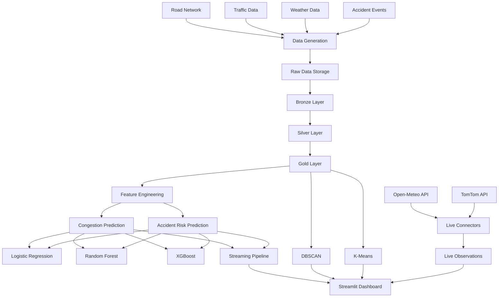

# 🚦 Smart Traffic Congestion & Accident Risk Analytics

<p align="center">
  <b>An End-to-End Big Data Analytics and Machine Learning Project for Traffic Congestion Prediction, Accident Risk Estimation and Geographical Hotspot Detection.</b>
</p>

<p align="center">
  
  
  
  
  
  
</p>

---

## 📌 Table of Contents

- [Overview](#-overview)
- [Project Objectives](#-project-objectives)
- [Key Features](#-key-features)
- [System Architecture](#-system-architecture)
- [Technology Stack](#-technology-stack)
- [Project Structure](#-project-structure)
- [Dataset Description](#-dataset-description)
- [Machine Learning Models](#-machine-learning-models)
- [Geographical Hotspot Detection](#-geographical-hotspot-detection)
- [Live API Integration](#-live-api-integration)
- [Streaming Pipeline](#-streaming-pipeline)
- [Dashboard](#-dashboard)
- [Installation and Setup](#-installation-and-setup)
- [How to Run the Project](#-how-to-run-the-project)
- [Environment Variables](#-environment-variables)
- [Output Files](#-output-files)
- [Testing](#-testing)
- [Evaluation Metrics](#-evaluation-metrics)
- [Limitations](#-limitations)
- [Future Improvements](#-future-improvements)
- [Contributors](#-contributors)
- [Academic Information](#-academic-information)

---

## 🌐 Overview

**Smart Traffic Congestion & Accident Risk Analytics** is an end-to-end data analytics and machine learning project designed to analyse traffic conditions, estimate accident risk and identify geographical accident hotspots across a Delhi-inspired road network.

The project brings together traffic information, weather conditions, road characteristics and accident observations to build a common analytical dataset. Machine learning algorithms are then used to predict traffic congestion and estimate the probability of an accident occurring during the next hour.

In addition to predictive modelling, the system uses geographical clustering techniques to identify areas with concentrated accident observations. Live weather and traffic information can also be retrieved through external APIs.

All major outputs are presented through an interactive Streamlit dashboard.

The project demonstrates how data engineering, machine learning, spatial analytics, API integration and visualisation can work together in a single analytical system.

### 🎯 What does the system do?

| Functionality | Description |
|---|---|
| Traffic Analytics | Analyses traffic speed, density and temporal patterns |
| Congestion Prediction | Predicts Low, Medium or High congestion one hour ahead |
| Accident Risk Prediction | Estimates the probability of an accident during the next hour |
| Accident Hotspot Detection | Identifies geographical clusters using DBSCAN |
| Road Segment Clustering | Groups road segments using K-Means |
| Weather Integration | Retrieves current weather information using Open-Meteo |
| Traffic Integration | Retrieves current traffic-flow observations using TomTom |
| Stream Processing | Replays historical observations and generates model predictions |
| Interactive Dashboard | Presents analytics and predictions through Streamlit |

---

## 🎯 Project Objectives

The main objectives of this project are:

1. Build an integrated dataset containing traffic, weather, road-network and accident information.
2. Analyse traffic patterns across different road segments and time periods.
3. Develop a machine learning system for one-hour-ahead congestion prediction.
4. Estimate accident occurrence risk using historical traffic and environmental features.
5. Compare Logistic Regression, Random Forest and XGBoost.
6. Identify geographical accident clusters using DBSCAN.
7. Group road segments using K-Means clustering.
8. Integrate external weather and traffic APIs.
9. Develop a streaming replay pipeline for generating predictions.
10. Create an interactive dashboard for exploring the analytical results.

---

## ✨ Key Features

### 1. Traffic Congestion Prediction

The system classifies the expected congestion condition of a road segment into three categories:

- 🟢 **Low:** Relatively free-flowing traffic.
- 🟡 **Medium:** Moderate traffic congestion.
- 🔴 **High:** Heavy traffic congestion.

The prediction task uses traffic, weather, road and temporal features to estimate the congestion category one hour ahead.

### 2. Accident Risk Estimation

The accident-risk model estimates the likelihood of an accident occurring during the next hour.

The task is formulated as binary classification:

- Accident
- No Accident

Since accident observations are less frequent than non-accident observations, the training process includes class-imbalance handling.

### 3. Geographical Hotspot Detection

Two clustering algorithms are implemented:

- DBSCAN for identifying dense geographical accident clusters.
- K-Means for grouping road segments and comparing their characteristics.

### 4. Live Data Integration

The system supports:

- Open-Meteo for current weather observations.
- TomTom Traffic Flow API for current traffic observations.

### 5. Interactive Dashboard

The Streamlit dashboard provides:

- Traffic analytics.
- Congestion prediction results.
- Accident-risk visualisation.
- Geographical hotspot maps.
- Live weather observations.
- Live traffic information.
- Model evaluation and comparison.

---

## 🏗️ System Architecture

The project follows a modular data-processing architecture with three main data layers: Bronze, Silver and Gold.



### Data Processing Layers

| Layer | Responsibility |
|---|---|
| Bronze | Stores ingested raw datasets in Parquet format |
| Silver | Cleans, validates and prepares traffic and weather data |
| Gold | Combines datasets and creates machine learning features and targets |

### Overall Workflow

1. Generate road-network, traffic, weather and accident information.
2. Store the generated data in the raw directory.
3. Convert the source datasets into Bronze Parquet files.
4. Clean and validate the data in the Silver layer.
5. Combine the datasets and generate features in the Gold layer.
6. Train and evaluate the machine learning models.
7. Perform geographical hotspot analysis.
8. Retrieve live observations from external APIs.
9. Run the streaming scoring pipeline.
10. Visualise the results through the dashboard.

---

## 🛠️ Technology Stack

| Category | Technologies |
|---|---|
| Programming Language | Python 3.12 |
| Data Manipulation | Pandas, NumPy |
| Machine Learning | Scikit-learn |
| Gradient Boosting | XGBoost |
| Numerical Processing | SciPy |
| Spatial Analysis | DBSCAN, K-Means, Haversine distance |
| Model Persistence | Joblib |
| Data Storage | CSV, Parquet, JSONL |
| API Integration | Requests |
| Weather API | Open-Meteo |
| Traffic API | TomTom |
| Data Visualisation | Plotly, Folium, Matplotlib, Seaborn |
| Dashboard | Streamlit |
| Testing | Pytest |
| Development Environment | Visual Studio Code |
| Optional Streaming Integration | Apache Kafka |

---

## 📁 Project Structure

The project is organised into separate directories to keep data, models, source code and dashboard components independent.

```text
smart-traffic-analytics/
│
├── app/
│   └── dashboard.py
│
├── config.py
│
├── data/
│   ├── raw/
│   ├── bronze/
│   ├── silver/
│   ├── gold/
│   └── stream_in/
│
├── docker/
│
├── models/
│
├── notebooks/
│
├── producer/
│
├── reports/
│
├── scripts/
│
├── src/
│   ├── __init__.py
│   ├── delhi_network.py
│   ├── generate_data.py
│   ├── data_engineering.py
│   ├── model_training.py
│   ├── hotspot_analysis.py
│   ├── live_connectors.py
│   └── streaming_pipeline.py
│
├── streaming/
│
├── tests/
│   └── test_generation.py
│
├── requirements.txt
│
└── README.md
```

### Important Directories

**`src/`**

Contains the main implementation modules:

- `delhi_network.py` – Creates the road network and blackspot references.
- `generate_data.py` – Generates the traffic, weather and accident datasets.
- `data_engineering.py` – Implements Bronze, Silver and Gold data processing.
- `model_training.py` – Trains and evaluates machine learning models.
- `hotspot_analysis.py` – Performs DBSCAN and K-Means clustering.
- `live_connectors.py` – Integrates external weather and traffic APIs.
- `streaming_pipeline.py` – Generates predictions using the saved models.

**`app/`**

Contains the Streamlit dashboard application.

**`data/`**

Stores raw, processed and streaming datasets.

**`models/`**

Contains the trained machine learning models saved using Joblib.

**`reports/`**

Contains model comparison results, hotspot summaries and other analytical outputs.

**`tests/`**

Contains automated tests for validating the data-generation process.

---

## 📊 Dataset Description

The project uses a generated historical dataset covering the period from **1 January 2024 to 31 March 2024**.

The road network contains 60 road segments distributed across 20 named Delhi-NCR corridors and seven blackspot reference areas.

### Dataset Summary

| Dataset | Records |
|---|---:|
| Road Segments | 60 |
| Hourly Weather Observations | 2,184 |
| Clean Traffic Observations | 131,040 |
| Traffic Records After Injecting Data Issues | 131,302 |
| Generated Accident Events | 9,262 |
| Final Gold Dataset | 130,800 |

### Traffic Features

- Segment ID
- Timestamp
- Average speed
- Vehicle density
- Road characteristics
- Free-flow speed

### Weather Features

- Temperature
- Humidity
- Rainfall
- Visibility
- Wind speed

### Temporal Features

- Hour of the day
- Day of the week
- Month
- Weekend indicator
- Cyclical time features

### Engineered Features

- Previous-hour speed
- Previous-hour density
- Rolling traffic observations
- Road-type encoding
- Weather-related features
- One-hour-ahead congestion target
- One-hour-ahead accident-risk target

### Data Quality Handling

To test the preprocessing pipeline, controlled data-quality issues were introduced into the generated traffic dataset.

These include:

- Missing speed observations.
- Missing density observations.
- Duplicate records.
- Zero-speed readings.
- Unrealistically high speed readings.

The preprocessing pipeline identifies and handles these issues before producing the final analytical dataset.

> **Important:** The historical traffic and accident records are synthetically generated for development and experimentation. They are not actual historical Delhi traffic sensor readings or verified accident records.

---

## 🤖 Machine Learning Models

The project implements three classification algorithms for each prediction task.

### Congestion Prediction

| Model | Task |
|---|---|
| Logistic Regression | Three-class congestion classification |
| Random Forest | Three-class congestion classification |
| XGBoost | Three-class congestion classification |

The output is one of the following:

```text
Low
Medium
High
```

### Accident Risk Prediction

| Model | Task |
|---|---|
| Logistic Regression | Binary accident-risk classification |
| Random Forest | Binary accident-risk classification |
| XGBoost | Binary accident-risk classification |

The model estimates the probability of an accident occurring during the next hour.

### Training and Testing Strategy

A chronological split is used to avoid randomly mixing earlier and later observations.

| Dataset | Period | Records |
|---|---|---:|
| Training | January–February 2024 | 86,220 |
| Testing | March 2024 | 44,580 |

This approach allows the models to be evaluated on a later period that was not used during training.

The fitted models are saved using Joblib and loaded later by the streaming pipeline.

---

## 📍 Geographical Hotspot Detection

The project uses two clustering algorithms to analyse the spatial distribution of accident observations.

### DBSCAN

DBSCAN groups geographically close accident observations based on density.

Configuration:

| Parameter | Value |
|---|---|
| Distance Metric | Haversine |
| Epsilon | 350 metres |
| Minimum Samples | 60 |

DBSCAN can identify dense geographical clusters without requiring the number of clusters to be specified in advance. It also identifies isolated observations as noise.

### K-Means

K-Means groups road segments based on their geographical and accident-related characteristics.

Different cluster counts are evaluated using the silhouette score. The implementation selects the best-performing candidate among the evaluated values.

The outputs include:

- DBSCAN accident labels.
- DBSCAN hotspot summaries.
- K-Means segment clusters.
- K-Means cluster summaries.
- Silhouette scores.
- Blackspot rankings.

---

## 🌦️ Live API Integration

The project supports external data integration through Open-Meteo and TomTom.

### Open-Meteo Weather API

Open-Meteo provides current weather observations for the Delhi reference location.

The connector retrieves:

- Temperature.
- Relative humidity.
- Precipitation.
- Visibility.
- Wind speed.

No API key is required for the Open-Meteo endpoint used in this project.

### TomTom Traffic Flow API

TomTom provides traffic-flow observations for seven representative blackspot locations.

The integration uses the Flow Segment Data API.

The retrieved information includes:

- Current speed.
- Free-flow speed.
- Current travel time.
- Free-flow travel time.
- Confidence information.
- Road-closure information.

A TomTom API key is required.

Create an account through the [TomTom Developer Portal](https://developer.tomtom.com/) and obtain an API key before enabling the connector.

See [Environment Variables](#-environment-variables) for configuration instructions.

> Live observations represent the time at which the API request was made. They are separate from the synthetic historical dataset.

---

## ⚡ Streaming Pipeline

The streaming pipeline demonstrates how trained machine learning models can be reused to score a sequence of traffic observations.

The current implementation:

1. Loads the best-performing saved model for each prediction task.
2. Reads the Gold analytical dataset.
3. Selects the latest available 72-hour historical window.
4. Processes records in chronological order.
5. Generates congestion and accident-risk predictions.
6. Saves the scored observations in CSV and JSONL formats.

### Output Files

```text
data/stream_in/
│
├── scored_stream.csv
└── scored_stream.jsonl
```

### Streaming Modes

**Local-file mode**

The implemented pipeline supports local-file output without requiring a Kafka broker.

**Optional Kafka integration**

Kafka publishing is supported when a Kafka broker is separately configured and the required Python package is installed.

The current local-file workflow does not require Docker or Kafka.

> The 72-hour processing window is a replay of available historical data, not a continuous live feed of current Delhi traffic.

---

## 📊 Dashboard

The project includes an interactive dashboard built using Streamlit.

It provides six main sections.

### 1. Overview

Displays project-level indicators, road-network information, congestion summaries and geographical information.

### 2. Traffic Analytics

Displays traffic speed, density and volume trends across the selected time period.

### 3. Accident Hotspots

Displays DBSCAN clusters, K-Means results, geographical hotspot information and blackspot rankings.

### 4. Prediction Centre

Displays congestion predictions and accident-risk probabilities generated by the scoring pipeline.

### 5. Live Monitoring

Displays current weather observations, available traffic observations and streaming outputs.

### 6. Model Evaluation

Displays model comparison results and visualisations based on the selected evaluation metric.

### Launch the Dashboard

```bash
streamlit run app/dashboard.py
```

Open the following address in your browser:

```text
http://localhost:8501
```

---

# 🚀 Installation and Setup

Follow these instructions to run the project locally.

## Prerequisites

Make sure the following are installed:

- Python 3.12
- Git
- Visual Studio Code (recommended)
- Internet connection for API integration and package installation

Optional:

- Docker, if you want to experiment with a separate Kafka deployment.

### Step 1: Clone the Repository

Open a terminal and run:

```bash
git clone https://github.com/YOUR_USERNAME/smart-traffic-analytics.git
```

Move into the project directory:

```bash
cd smart-traffic-analytics
```

Replace `YOUR_USERNAME` with the GitHub account or organisation that hosts the repository.

### Step 2: Create a Virtual Environment

Create an isolated Python environment:

```bash
python -m venv .venv
```

### Step 3: Activate the Environment

**Windows PowerShell:**

```powershell
.\.venv\Scripts\Activate.ps1
```

If PowerShell blocks script execution, run:

```powershell
Set-ExecutionPolicy -Scope Process -ExecutionPolicy Bypass
```

Then activate the environment again:

```powershell
.\.venv\Scripts\Activate.ps1
```

**Windows Command Prompt:**

```cmd
.venv\Scripts\activate.bat
```

**Linux / macOS:**

```bash
source .venv/bin/activate
```

After activation, the terminal should display:

```text
(.venv)
```

### Step 4: Upgrade pip

```bash
python -m pip install --upgrade pip
```

### Step 5: Install Dependencies

Install the required Python libraries:

```bash
pip install -r requirements.txt
```

Wait until the installation is complete.

### Step 6: Configure Environment Variables

Open-Meteo works without an API key.

For TomTom, configure your API key as explained in the [Environment Variables](#-environment-variables) section.

If you are not using TomTom, you can leave the key unset. The connector will skip that integration.

---

# ▶️ How to Run the Project

Run the following commands from the project root directory with the virtual environment activated.

**Important:** Run the modules in the order shown below because later stages depend on the output files created by earlier stages.

## Step 1: Generate the Dataset

```bash
python -m src.generate_data
```

This generates:

- Road-network information.
- Hourly weather observations.
- Traffic observations.
- Synthetic accident events.

The raw CSV files are stored in:

```text
data/raw/
```

## Step 2: Process the Data

```bash
python -m src.data_engineering
```

This performs the following operations:

- Bronze layer creation.
- Silver layer cleaning.
- Duplicate removal.
- Missing-value handling.
- Traffic and weather integration.
- Feature engineering.
- Gold dataset generation.

The processed datasets are stored under:

```text
data/bronze/
data/silver/
data/gold/
```

## Step 3: Train Machine Learning Models

```bash
python -m src.model_training
```

This trains all six classification models.

The trained models are saved in:

```text
models/
```

The model comparison report is saved in:

```text
reports/model_comparison.csv
```

## Step 4: Perform Hotspot Analysis

```bash
python -m src.hotspot_analysis
```

This executes DBSCAN and K-Means clustering and generates hotspot summaries and cluster evaluation outputs.

The results are stored in:

```text
reports/
```

## Step 5: Retrieve Live Data

```bash
python -m src.live_connectors
```

This retrieves the latest weather information from Open-Meteo.

If a valid TomTom API key is configured, the connector also attempts to retrieve traffic-flow observations.

The outputs are saved in:

```text
data/stream_in/
```

## Step 6: Run the Streaming Pipeline

```bash
python -m src.streaming_pipeline
```

This loads the trained models and generates predictions for the latest available 72-hour historical window.

The results are saved as:

```text
data/stream_in/scored_stream.csv
data/stream_in/scored_stream.jsonl
```

## Step 7: Launch the Dashboard

```bash
streamlit run app/dashboard.py
```

Open:

```text
http://localhost:8501
```

You can now explore the dashboard and view the generated analytical results.

### Complete Execution Sequence

For convenience, the complete execution sequence is:

```bash
python -m src.generate_data

python -m src.data_engineering

python -m src.model_training

python -m src.hotspot_analysis

python -m src.live_connectors

python -m src.streaming_pipeline

streamlit run app/dashboard.py
```

Each command should finish successfully before moving to the next stage.

---

## 🔐 Environment Variables

The project uses environment variables for optional external service configuration.

### TomTom API Key

Obtain your API key from:

https://developer.tomtom.com/

**Windows PowerShell:**

```powershell
$env:TOMTOM_API_KEY="YOUR_TOMTOM_API_KEY"
```

**Windows Command Prompt:**

```cmd
set TOMTOM_API_KEY=YOUR_TOMTOM_API_KEY
```

**Linux / macOS:**

```bash
export TOMTOM_API_KEY="YOUR_TOMTOM_API_KEY"
```

After setting the variable, execute:

```bash
python -m src.live_connectors
```

Do not upload your API key to GitHub.

If you prefer persistent local configuration, you can use a `.env` file if the project environment has the appropriate environment-variable loader configured. Never commit that file.

### Optional Kafka Configuration

The streaming pipeline can also publish to Kafka when a broker is available.

Set the broker address:

```powershell
$env:KAFKA_BOOTSTRAP_SERVERS="localhost:9092"
```

A Kafka broker must already be running and reachable. Installing the Python Kafka package alone does not start a broker.

Kafka is optional. The local-file workflow works without it.

---

## 📦 Output Files

After running the project, the main output files are organised as follows.

| File | Description |
|---|---|
| `data/raw/segments.csv` | Generated road-segment information |
| `data/raw/traffic.csv` | Generated traffic observations |
| `data/raw/weather.csv` | Generated hourly weather observations |
| `data/raw/accidents.csv` | Generated accident events |
| `data/gold/model_dataset.csv` | Final analytical dataset |
| `data/gold/model_dataset.parquet` | Final analytical dataset in Parquet format |
| `models/congestion_logistic_regression.joblib` | Congestion Logistic Regression model |
| `models/congestion_random_forest.joblib` | Congestion Random Forest model |
| `models/congestion_xgboost.joblib` | Congestion XGBoost model |
| `models/accident_logistic_regression.joblib` | Accident Logistic Regression model |
| `models/accident_random_forest.joblib` | Accident Random Forest model |
| `models/accident_xgboost.joblib` | Accident XGBoost model |
| `reports/model_comparison.csv` | Model evaluation results |
| `reports/dbscan_hotspots.csv` | DBSCAN hotspot summaries |
| `reports/kmeans_segment_clusters.csv` | K-Means segment cluster results |
| `reports/blackspot_ranking.csv` | Blackspot ranking |
| `data/stream_in/live_weather.csv` | Retrieved weather observations |
| `data/stream_in/live_traffic.csv` | Retrieved traffic observations |
| `data/stream_in/scored_stream.csv` | Streaming prediction results |
| `data/stream_in/scored_stream.jsonl` | Streaming predictions in JSONL format |

Some report and output files are generated only after their corresponding module has been executed.

---

## 🧪 Testing

The project includes automated tests for validating the data-generation process.

To execute the tests, run:

```bash
python -m pytest tests/test_generation.py -v
```

The tests check:

- Expected number of road segments.
- Road-type distribution.
- Generated weather observations.
- Traffic record generation.
- Injected data-quality issues.
- Accident records and their references.
- Date-range consistency.

A successful execution should report:

```text
6 passed
```

These tests help verify that the data-generation stage produces the expected outputs.

---

## 📈 Evaluation Metrics

Different evaluation metrics are used depending on the prediction task.

### Congestion Prediction

| Metric | Purpose |
|---|---|
| Accuracy | Overall prediction correctness |
| Precision | Correctness of positive class predictions |
| Recall | Ability to identify observations belonging to each class |
| Weighted F1-score | Overall class-weighted classification performance |
| Macro F1-score | Equal-weight evaluation across congestion classes |
| Confusion Matrix | Shows correct and incorrect class predictions |

### Accident Risk Prediction

| Metric | Purpose |
|---|---|
| Accuracy | Overall classification correctness |
| Precision | Reliability of predicted accident cases |
| Recall | Ability to identify accident cases |
| F1-score | Balance between precision and recall |
| ROC-AUC | Ability to distinguish positive and negative cases |
| PR-AUC | Performance on the positive accident class |
| Top-10% Accident Capture | Accident observations captured in the highest-risk 10% |

### Clustering Evaluation

| Metric | Purpose |
|---|---|
| Silhouette Score | Measures K-Means cluster separation |
| Number of Clusters | Indicates identified geographical groups |
| Noise Observations | Indicates DBSCAN observations not assigned to a cluster |
| Cluster Distribution | Helps interpret the geographical concentration of observations |

---

## ⚠️ Limitations

The current implementation has some important limitations that should be considered when interpreting its results.

1. **Synthetic historical data:** The historical traffic and accident datasets are generated through simulation rather than collected from actual Delhi traffic sensors.

2. **Approximate road coordinates:** The geographical coordinates are representative simulation locations, not surveyed road-centreline measurements.

3. **Limited live traffic coverage:** TomTom integration covers seven representative blackspot locations rather than all 60 road segments.

4. **Weather coverage:** The current weather integration uses a Delhi reference location instead of separate weather observations for every road segment.

5. **Historical replay:** The streaming pipeline replays the latest available 72-hour historical dataset. It is not yet a continuously operating real-time traffic ingestion service.

6. **Kafka deployment:** Kafka publishing is optional and requires a separately configured broker.

7. **Real-world validation:** Model performance on synthetic data does not establish real-world predictive accuracy. Testing with verified traffic and accident datasets is necessary before operational deployment.

8. **Prediction scope:** The system estimates next-hour congestion and binary accident risk. It does not predict accident severity or control traffic signals.

---

## 🔮 Future Improvements

Some possible extensions include:

- Integrating verified Delhi traffic and accident datasets.
- Expanding traffic monitoring to more road segments.
- Using geographically distributed weather observations.
- Implementing a continuously running Kafka-based ingestion system.
- Integrating official road-network GIS data.
- Adding more advanced time-series forecasting models.
- Introducing real-time alerts for high congestion and accident-risk observations.
- Improving the dashboard with additional filters and geographical drill-downs.
- Deploying the application on a cloud platform.
- Evaluating model performance on unseen real-world traffic data.

---

## 👨‍💻 Contributors

This project was developed as a collaborative academic project.

| Team Member | Enrollment Number |


| Daksh Goyal | S24CSEU2379 |

| Atharva Dubey | S24CSEU0017 |

| Vasu Keshri | S24CSEU1166 |

| Kanika Bansal | S24CSEU0646 |

---

## 🎓 Academic Information

**Project Title:** Smart Traffic Congestion & Accident Risk Analytics

**Course:** CSET 371 – Big Data Analytics and Business Intelligence

**University:** Bennett University, Greater Noida

**School:** School of Computer Science Engineering and Technology (SCSET)

**Faculty Guide:** Dr. Surendra Tripathi

---

## ⭐ Acknowledgements

We would like to express our gratitude to our faculty guide and the School of Computer Science Engineering and Technology for their guidance and support throughout the development of this project.

We also acknowledge the developers and maintainers of the open-source libraries and data services used in this implementation, including Python, Pandas, NumPy, Scikit-learn, XGBoost, Streamlit, Plotly, Folium and Open-Meteo.

---

<p align="center">
  <b>🚦 Smart Traffic Congestion & Accident Risk Analytics</b>
  <br/>
  Turning traffic data into meaningful analytical insights.
  <br/><br/>
  <i>Built with Python, Machine Learning and Big Data Analytics.</i>
</p>
